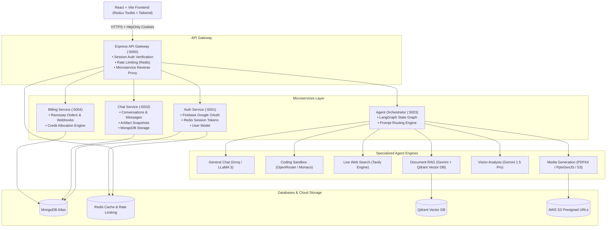

# CortexAI

> **Production-grade multi-agent AI workspace with autonomous intent routing, microservice architecture, dynamic code execution sandboxes, and vector-backed document intelligence.**

[](https://react.dev/)
[](https://nodejs.org/)
[](https://expressjs.com/)
[](https://langchain-ai.github.io/langgraphjs/)
[](https://www.mongodb.com/)
[](https://redis.io/)
[](https://qdrant.tech/)
[](https://aws.amazon.com/s3/)
[](https://razorpay.com/)

---

## 📌 Why I Built This

Most modern AI apps are thin wrappers around a single LLM API endpoint. As a final-year CS student wanting to understand how real-world, enterprise-grade AI platforms operate, I designed **CortexAI** from first principles to explore:
1. **Decoupled Microservices**: Splitting monolithic AI logic into isolated services (API Gateway, Auth, Chat/Artifacts, Agent Orchestrator, Billing) communicating over internal networks.
2. **Autonomous Intent Routing**: Instead of forcing the user to manually toggle models, a central **LangGraph** state machine analyzes prompt semantics and multimodal attachments (PDFs, images) to dynamically select the optimal agent pipeline.
3. **End-to-End Multimodal Execution**: Beyond simple text output, CortexAI generates downloadable slide decks (PPTX), formatted PDFs, runs live code in an interactive Monaco sandbox, searches the live web, and indexes complex documents into a vector database for semantic retrieval.

---

## 📸 Product Walkthrough

| Live Interactive Code Sandbox & Artifact Preview | Credit-Based Tiering & Razorpay Billing Drawer |
| :---: | :---: |
|  |  |

---

## 🏗️ System Architecture



---

## ⚙️ Key Engineering Highlights

### 1. LangGraph Autonomous Router
Rather than relying on basic `if/else` keyword matching, requests pass through a compiled LangGraph state graph. The routing node inspects user prompts, conversational context from Redis, and multipart file payloads to classify user intent:
- `Auto Mode`: Routes to `chat`, `coding`, `search`, `pdf`, `ppt`, or `vision`.
- `Deterministic Override`: Users can explicitly pin specific agents when they need strict task execution.

### 2. Retrieval-Augmented Generation (RAG) on Documents
- Uploaded PDFs are parsed, split into semantically coherent text chunks, and embedded via Google Gemini Embeddings.
- Chunk vectors and metadata are stored in a dedicated **Qdrant Vector Database** collection.
- Top-k cosine similarity matches are injected into the agent prompt context with source page citations.

### 3. In-Browser Live Code Sandbox
- Generates HTML, CSS, JavaScript, and React snippets on the fly.
- Rendered in a sandboxed iframe with Monaco Editor integration, allowing real-time code editing, live DOM preview, and one-click copy/download.

### 4. Resilient Multi-Provider LLM Orchestration
- **Groq**: Ultra-low-latency conversational inference.
- **OpenRouter**: Specialized programming and code reasoning models.
- **Google Gemini**: Multimodal vision analysis and dense text embeddings.
- **Tavily AI**: Context-rich web search extraction with image indexing.

### 5. Production Billing & Redis Rate Limiting
- Dynamic credit deduction matrix: Different models consume credits proportionally based on token and compute intensity.
- Cryptographic verification of Razorpay signatures on the backend before crediting balances.
- Sliding-window rate limiter powered by Redis to guard endpoints against abuse.

---

## 🛠️ Microservice Directory Breakdown

| Directory | Responsibility | Port | Primary Tech |
| :--- | :--- | :--- | :--- |
| `backend/gateway` | Public entry point; validates JWT cookies, verifies Redis sessions, reverse-proxies requests | `:5000` | Express, Redis, Axios |
| `backend/services/auth` | Firebase OAuth token verification, user profile management, credit balance sync | `:5001` | Firebase Admin, MongoDB |
| `backend/services/chat` | Persistent conversations, message histories, and generated artifact snapshots | `:5002` | Express, Mongoose |
| `backend/services/agent` | LangGraph routing, tool calling, vector search, file generation, and S3 uploads | `:5003` | LangGraph, Gemini, Qdrant, S3 |
| `backend/services/billing`| Razorpay checkout order generation, webhook signature verification | `:5004` | Razorpay SDK, Mongoose |
| `frontend` | Single-page application, Monaco Editor code preview, chat streaming UI | `:5173` | React 18, Vite, Redux Toolkit, Tailwind |

---

## 🚀 Local Development Setup

### Prerequisites
- Node.js `20.x` or higher
- Docker & Docker Compose (for Redis and Qdrant)
- MongoDB instance (local or MongoDB Atlas URI)
- API Keys: Groq, Gemini, OpenRouter, Tavily, AWS S3, Firebase Admin, Razorpay

### 1. Clone & Install Dependencies
```bash
git clone https://github.com/V-Rytham/cortexai.git
cd cortexai

# Install root dependencies
npm install --prefix backend/gateway
npm install --prefix backend/services/auth
npm install --prefix backend/services/chat
npm install --prefix backend/services/agent
npm install --prefix backend/services/billing
npm install --prefix frontend
```

### 2. Start Supporting Infrastructure
Run Redis via Docker Compose:
```bash
docker compose -f backend/docker-compose.yml up -d
```

### 3. Environment Configuration
Populate `.env` files in:
- `backend/gateway/.env` (`PORT=5000`, `REDIS_URL`, microservice URLs)
- `backend/services/auth/.env` (`PORT=5001`, `MONGO_URI`, Firebase keys)
- `backend/services/chat/.env` (`PORT=5002`, `MONGO_URI`)
- `backend/services/agent/.env` (`PORT=5003`, `GROQ_API_KEY`, `GEMINI_API_KEY`, `QDRANT_URL`, `AWS_ACCESS_KEY_ID`, etc.)
- `backend/services/billing/.env` (`PORT=5004`, `RAZORPAY_KEY_ID`, `RAZORPAY_KEY_SECRET`)
- `frontend/.env` (`VITE_SERVER_URL=http://localhost:5000`)

### 4. Run Development Servers
Start each service using npm scripts:
```bash
npm run dev --prefix backend/gateway
npm run dev --prefix backend/services/auth
npm run dev --prefix backend/services/chat
npm run dev --prefix backend/services/agent
npm run dev --prefix backend/services/billing
npm run dev --prefix frontend
```

The web client will be available at `http://localhost:5173`.

---

## 🧑‍💻 Author

**Rytham Maalpani**  
- Final Year Computer Science Undergraduate  
- GitHub: [@V-Rytham](https://github.com/V-Rytham)
