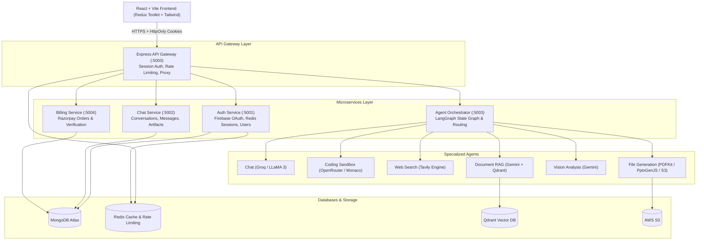

# CortexAI

> Multi-agent AI workspace with autonomous intent routing, microservice architecture, dynamic code execution sandboxes, and vector-backed document intelligence.

[](https://react.dev/)
[](https://nodejs.org/)
[](https://expressjs.com/)
[](https://langchain-ai.github.io/langgraphjs/)
[](https://www.mongodb.com/)
[](https://redis.io/)
[](https://qdrant.tech/)
[](https://aws.amazon.com/s3/)
[](https://razorpay.com/)

---

## Overview

Instead of jumping between separate tools for conversation, live web search, coding sandboxes, and PDF Q&A, I built **CortexAI** as an integrated multi-agent platform:
- **Autonomous Intent Routing**: A central LangGraph state graph analyzes prompts and file attachments to dispatch tasks to specialized agent pipelines automatically.
- **Decoupled Microservices**: Express API Gateway with session authentication, Redis caching, and independent services for Auth, Chat, Agents, and Billing.
- **Live Code Sandbox**: Generates and previews HTML/CSS/JS in Monaco Editor with live iframe rendering.
- **Document Intelligence**: Chunks uploaded PDFs, embeds them with Gemini, and stores vectors in Qdrant for semantic RAG retrieval.

---

## Screenshots

| Live Code Sandbox & Artifact Preview | Credits & Razorpay Billing Drawer |
| :---: | :---: |
|  |  |

---

## Architecture



---

## Key Highlights

- **LangGraph State Routing**: Dynamically routes requests to `chat`, `coding`, `search`, `pdf`, `ppt`, or `vision` pipelines based on prompt semantics and multipart file payloads.
- **Document RAG with Qdrant**: Recursive text chunking, dense vector embeddings via Google Gemini, and cosine similarity lookup with source citations.
- **Monaco Code Sandbox**: Live in-browser editing and sandboxed iframe rendering with syntax highlighting and instant download.
- **Multi-Provider Fallback**: Groq for low-latency dialogue, OpenRouter for code generation, Gemini for vision and embeddings, and Tavily for live web search.
- **Credit Allocation & Billing**: Sliding-window rate limiting via Redis, atomic credit deductions per model tier, and cryptographically verified Razorpay orders.

---

## Service Breakdown

| Directory | Responsibility | Port | Tech Stack |
| :--- | :--- | :--- | :--- |
| `backend/gateway` | Public entry point; validates JWT cookies, verifies Redis sessions, reverse-proxies requests | `:5000` | Express, Redis, Axios |
| `backend/services/auth` | Firebase OAuth token verification, user profile management, credit balance sync | `:5001` | Firebase Admin, MongoDB |
| `backend/services/chat` | Persistent conversations, message histories, and generated artifact snapshots | `:5002` | Express, Mongoose |
| `backend/services/agent` | LangGraph routing, tool calling, vector search, file generation, and S3 uploads | `:5003` | LangGraph, Gemini, Qdrant, S3 |
| `backend/services/billing`| Razorpay checkout order generation, webhook signature verification | `:5004` | Razorpay SDK, Mongoose |
| `frontend` | Single-page application, Monaco Editor code preview, chat streaming UI | `:5173` | React 18, Vite, Redux Toolkit, Tailwind |

---

## Setup & Local Run

### Prerequisites
- Node.js 20+
- Docker & Docker Compose (for Redis and Qdrant)
- MongoDB instance (local or Atlas)

### 1. Install Dependencies
```bash
git clone https://github.com/V-Rytham/cortexai.git
cd cortexai

npm install --prefix backend/gateway
npm install --prefix backend/services/auth
npm install --prefix backend/services/chat
npm install --prefix backend/services/agent
npm install --prefix backend/services/billing
npm install --prefix frontend
```

### 2. Start Supporting Services
```bash
docker compose -f backend/docker-compose.yml up -d
```

### 3. Start Development Servers
```bash
npm run dev --prefix backend/gateway
npm run dev --prefix backend/services/auth
npm run dev --prefix backend/services/chat
npm run dev --prefix backend/services/agent
npm run dev --prefix backend/services/billing
npm run dev --prefix frontend
```

Web client runs at `http://localhost:5173`.
